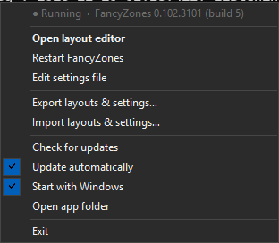
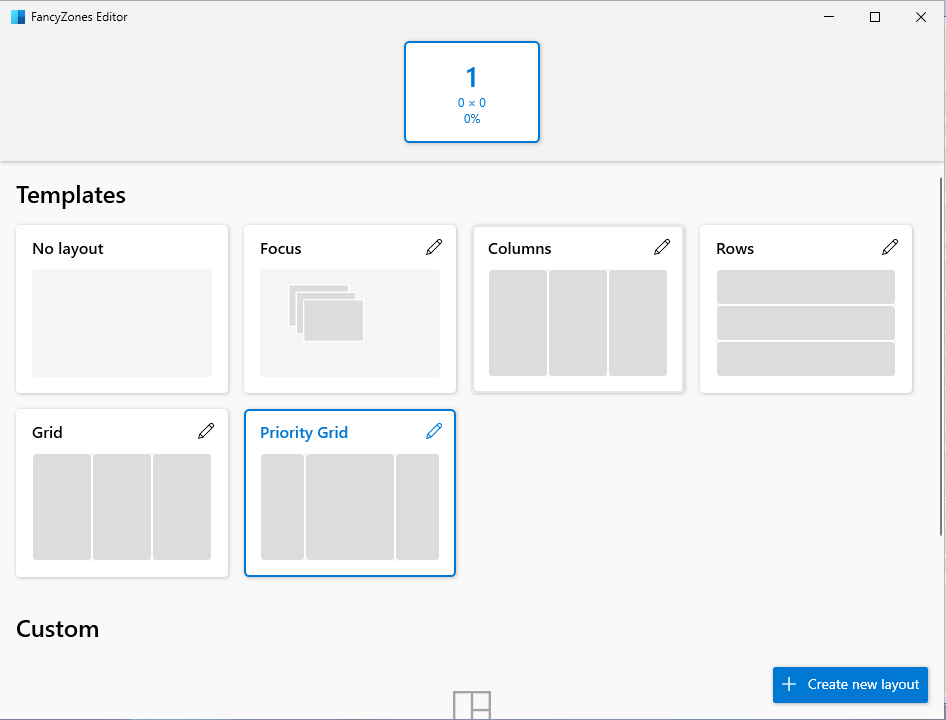

# FancyZones Standalone

Microsoft PowerToys' **FancyZones**, without the rest of PowerToys. No installer, no admin rights.

> ⚠️ This project is **100% vibe coded** (written by AI, reviewed by a human).




## Features

- **FancyZones only:** official, Microsoft-signed FancyZones binaries taken from each PowerToys release.
- **Tray app:** open the layout editor, restart FancyZones, start with Windows.
- **Auto-update:** checks this repo's releases every 6 h, verifies SHA256, swaps files in place. Your layouts are kept.
- **Export / import:** layouts, hotkeys and settings in one `.zip` (a backup is made before every import).
- **Builds only when FancyZones changes:** CI checks PowerToys every 6 h and releases only if the FancyZones source changed.

## Install

1. Download the zip from [Releases](../../releases/latest).
2. Extract it to a folder you own, e.g. `%USERPROFILE%\Apps\FancyZones`.
3. Run `FancyZonesStandalone.exe`. Double-click the tray icon (or press **Win+Shift+`**) to edit layouts.

## Command line

```
FancyZonesStandalone.exe --export backup.zip
FancyZonesStandalone.exe --import backup.zip
```

## How it's built

[`build/Build-Package.ps1`](build/Build-Package.ps1) downloads `PowerToysUserSetup-*-x64.exe`, checks its Microsoft signature, extracts the MSI (`wix burn extract` → `msiexec /a`), and copies only the files FancyZones uses. [`build.yml`](.github/workflows/build.yml) smoke-tests the result on Windows before releasing.

## Credits

FancyZones © Microsoft, [MIT](THIRD-PARTY-NOTICES.txt). Method based on [rolandas-rimkus/FancyZones](https://github.com/rolandas-rimkus/FancyZones). Not affiliated with Microsoft.
